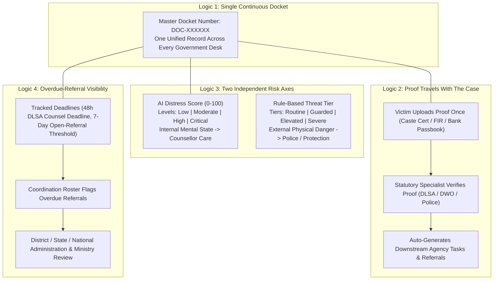
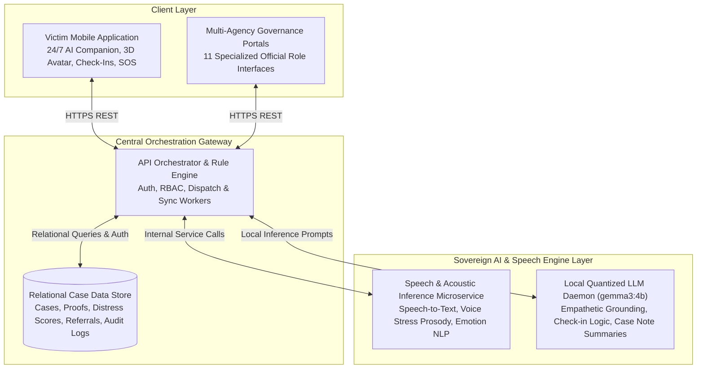
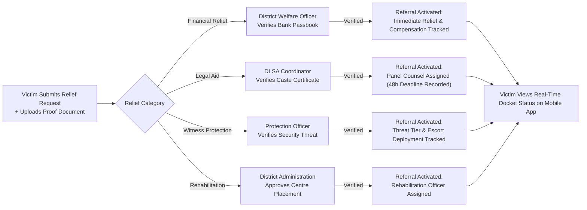
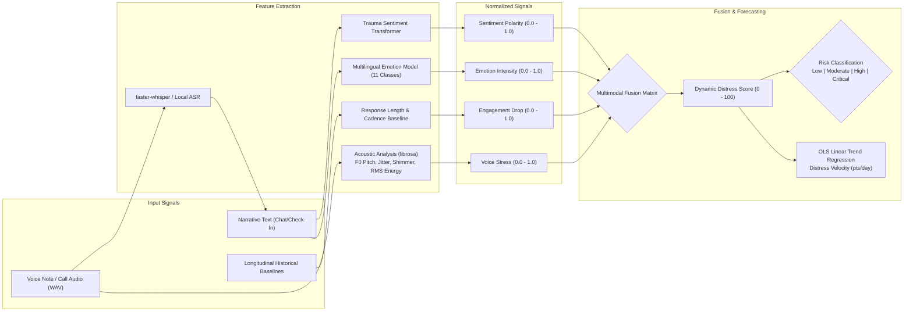
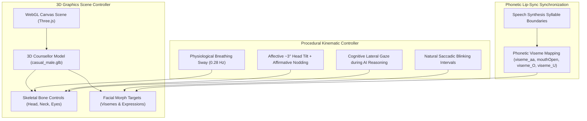
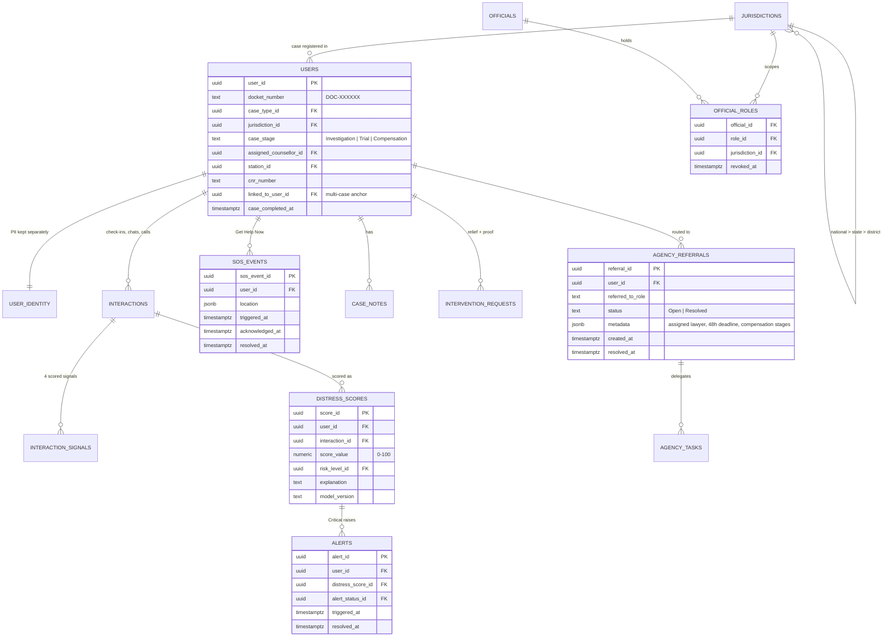

# Mansakha (मानसखा) 

### *Mind Matters — We Are Listening*

> **Dual-Interface Digital Ecosystem for SC/ST (Prevention of Atrocities) Act Victim Support & Multi-Agency Case Coordination**
> *Developed for the Ministry of Social Justice and Empowerment (MoSJE), Government of India*
> *Grounded in the SC/ST (PoA) Act 1989, Dr. Ambedkar National Relief Scheme, NALSA Legal-Aid Entitlements & DPDP Act 2023*

---

## 1. Problem Statement Mapping & Systemic Vision

Under the **Scheduled Castes and the Scheduled Tribes (Prevention of Atrocities) Act, 1989 (PoA Act)**, an atrocity survivor must navigate a complex, fragmented network of separate government departments:

1. **The Police Station**: Registers the First Information Report (FIR) and conducts the investigation.
2. **The District Welfare Officer (DWO)**: Verifies social welfare documentation and sanctions statutory financial relief.
3. **The District Legal Services Authority (DLSA)**: Mandated under NALSA guidelines to assign free legal counsel.
4. **The Protection Officer & Police Unit**: Evaluates physical security threats, witness intimidation, and safe-house needs.
5. **The District Collector’s Vigilance & Monitoring Committee (DVMC)**: Statutory committee mandated by law to review case pendency and welfare delivery.
6. **Rehabilitation Centres & District Mental Health Programme (DMHP)**: Manages post-trial recovery, vocational training, and long-term psychosocial care.

```
       ┌─────────────────────────────────────────────────────────────────┐
       │               THE CURRENT SYSTEMIC BREAKDOWN                    │
       ├────────────────────────────────┬────────────────────────────────┤
       │ 1. Repeated Trauma Narration   │ Victim re-narrates incident at │
       │                                │ every separate official desk.  │
       ├────────────────────────────────┼────────────────────────────────┤
       │ 2. Disconnected Mental Health  │ Psychological care is entirely │
       │                                │ isolated from legal processes. │
       ├────────────────────────────────┼────────────────────────────────┤
       │ 3. Opaque Financial Relief     │ No tracking for multi-stage    │
       │                                │ statutory compensation disbursal│
       ├────────────────────────────────┼────────────────────────────────┤
       │ 4. Unactioned Threats          │ Intimidation raised at welfare │
       │                                │ never reaches the police unit. │
       ├────────────────────────────────┼────────────────────────────────┤
       │ 5. Passive Committee Oversight │ DVMC reviews paper registers   │
       │                                │ long after legal deadlines lapse│
       └────────────────────────────────┴────────────────────────────────┘
```

### The Mansakha Solution Plan

**Mansakha (मानसखा — *"Mind Matters — We Are Listening"*)** resolves PS 094 by replacing disconnected physical paper trails with a synchronized dual-interface ecosystem:

- **For the Beneficiary / Survivor**: A single, continuous mobile companion providing 24/7 empathetic conversational grounding, proactive distress monitoring, a real-time 3-stage compensation tracker, and one-tap emergency SOS dispatch.
- **For Government Stakeholders**: Eleven role-scoped web portals connected to a single continuous case docket (`DOC-XXXXXX`). Every agency works from its own specialized queue while reading from and writing to a single shared truth.

---

## 2. Core Architectural Innovations & System Logics

The architecture is built upon seven foundational structural logics designed to resolve the systemic delays and institutional trauma of atrocity case management:



### 1. The Single Continuous Case Docket (`DOC-XXXXXX`)

Instead of each department maintaining an independent physical file, every registered incident is assigned a permanent master docket identifier (`DOC-XXXXXX`). This record persists across the survivor's entire journey—from initial police intake and welfare sanctioning through court trial and post-verdict rehabilitation.

### 2. "Proof Travels with the Case" (Single-Verification Pipeline)

Victims upload essential documentation (caste certificate, FIR copy, bank passbook) **only once** through the mobile interface. Verification is performed exclusively by the statutory specialist legally designated for that proof:

- **Caste Certificate**: Verified by the **DLSA Coordinator** to unlock free legal counsel.
- **Bank Passbook**: Verified by the **District Welfare Officer** to unlock Direct Benefit Transfer (DBT) relief.
- **FIR Copy**: Verified by the **Investigating Officer** to confirm police registration.

Once verified, downstream agency referrals and payment milestones unlock automatically—eliminating repeated physical paperwork.

### 3. Two Axes of Risk, Kept Strictly Independent

To prevent clinical trauma from being confused with physical witness intimidation, the system computes two completely independent risk metrics with mutually exclusive vocabularies:

- **Axis A: AI-Derived Distress Score ($0-100$) — Mental Health State**:
  - Risk Levels: **Low** ($0-29$), **Moderate** ($30-54$), **High** ($55-79$), **Critical** ($80-100$).
  - Evaluates internal psychological trauma, depression, voice stress, and affective distress from check-ins, chats, voice notes, and IVRS calls.
  - Directly drives the **Counsellor** therapeutic care queue.
- **Axis B: Rule-Based Threat Tier — Physical Security & Danger**:
  - Threat Tiers: **Routine**, **Guarded**, **Elevated**, **Severe**.
  - Evaluates external physical safety, accused bail status, and witness intimidation through deterministic, auditable statutory rules:
    - **Severe**: Accused is *Absconding* OR survivor has triggered $\ge 2$ SOS emergency events in the past 7 days.
    - **Elevated**: Accused is *Out on Bail* in a case marked *Witness Facing Intimidation or Threats* OR survivor has triggered $\ge 1$ SOS events in the past 7 days.
    - **Guarded**: Accused is *Out on Bail* (standard atrocity charge).
    - **Routine**: Accused is confirmed *In Custody* or *Convicted*.
    - *Not Yet Assessed*: Initial state before IO status entry and SOS logs.
  - Directly drives the **Protection Officer** and **Police** physical security queue.

### 4. Overdue-Referral Visibility for Administration

Delays are made visible rather than left buried in paper registers:

- Every inter-agency referral carries its open date; any referral left **open for more than 7 days** is flagged as overdue on the **Coordination Roster** that District, State, and National Administration and the Ministry all review.
- When a DLSA Coordinator assigns panel counsel, a **48-hour deadline** is recorded against that referral.

Overdue items are surfaced for human oversight and directives — the system flags them; an official decides what happens next.

### 5. Transparent 3-Stage Statutory Compensation Tracker

Grounded directly in the **Dr. Ambedkar National Relief Scheme** and the PoA Act statutory compensation schedules, the victim interface displays an auditable 3-stage visual progress tracker:

- **Stage 1 (Immediate Relief / 50%)**: Disbursed upon FIR registration and initial welfare verification.
- **Stage 2 (Investigation Complete / 25%)**: Disbursed when the Investigating Officer files the chargesheet in the Special Court.
- **Stage 3 (Trial Conclusion / 25%)**: Disbursed upon trial verdict or final judicial pronouncement.

### 6. One-Tap Emergency Multi-Agency Fan-Out

Activating the emergency SOS trigger executes a coordinated parallel protocol:

1. Opens the native device dialler directly to the **Police Control Room (100)**.
2. Captures GPS coordinates (best-effort, with explicit user permission).
3. Simultaneously raises a real-time high-priority alert to the **Assigned Counsellor** (auto-assigning the least-loaded counsellor nationwide if none exists yet) and opens a real, actionable referral with the survivor's own **Protection Officer** — deliberately scoped to these two roles only, so the survivor's most sensitive moment reaches the people positioned to act immediately rather than being diffused across the full administrative chain.

### 7. Telephonic IVRS Outreach & Automated Disengagement Logic

To ensure universal accessibility for rural, illiterate, or non-smartphone populations, the platform is architected around a telecom-agnostic dispatch queue that every outbound IVRS call and SMS check-in prompt passes through — attempted, retried with backoff, and logged the same way for every channel, so plugging in a live telecom gateway is a credentials change, not a re-architecture:

- **Automated Outbound Calling (queued, gateway pending)**: The system already decides *when* a survivor is due for a check-in call and queues it for dispatch; placing the live call requires telephony credentials (e.g. Exotel) that are not yet provisioned in this build, so calls are queued and logged rather than actually placed today.
- **Disengagement Detection — live today via check-ins, designed for IVRS**: The mechanism that is fully wired and running right now flags a survivor who has gone quiet for **7 days** across chat, check-ins, and calls — it auto-assigns a human counsellor (nationwide least-loaded, if none is assigned yet) and raises a high-priority follow-up alert. Once live telephony is connected, an **unanswered call, or one disconnected within 5 seconds**, is designed to feed the same signal immediately rather than waiting out the 7-day window.
- **Multimodal Acoustic Scoring on Completed Calls**:
  - When a call is completed, the voice audio is passed through local ASR and acoustic prosody models.
  - Extracts vocal tension ($F_0$ pitch instability, jitter, shimmer), transcribes text, evaluates trauma sentiment/emotion, and calculates the Dynamic Distress Score asynchronously.
- **Ministry-Level Telephony Audit Log**: Every queued, attempted, retried, and delivered dispatch — IVRS calls and SMS prompts alike — is logged in a central registry the National Ministry dashboard already reads from, so outreach parity is auditable the moment the telecom gateway goes live.

---

## 3. System Architecture & Component Roles

The platform is structured into four sovereign tiers, ensuring data privacy and operational autonomy across government infrastructure:



### Functional Tier Breakdown

| System Layer                             | Architectural Role & Scope | Key Operational Responsibilities                                                                                                                                                     |
| :--------------------------------------- | :------------------------- | :----------------------------------------------------------------------------------------------------------------------------------------------------------------------------------- |
| **Client Experience Layer**        | Mobile & Web Interfaces    | Native mobile experience for victims (Android/iOS/Web); eleven dedicated, role-scoped browser portals for government officials.                                                      |
| **Central Orchestration Gateway**  | API & Rules Engine         | Enforces Role-Based Access Control (RBAC), manages the single case docket lifecycle, runs background dispatch and court-status sync workers, and writes an audit log of every change. |
| **Relational Data Store**          | Relational Database        | Secure persistence for multi-agency case records, evidence documents (behind time-limited signed URLs), longitudinal distress timeseries, and inter-agency referral logs.            |
| **Speech & Acoustic Microservice** | Edge ML Inference          | Local execution of Indian-accented speech-to-text transcription, acoustic vocal prosody extraction ($F_0$ pitch, jitter, shimmer), and multilingual trauma emotion classification. |
| **Local LLM Daemon**               | Generative Reasoning       | Sovereign, on-premises language model generating empathetic conversational therapy turns, adaptive check-in questions, clinical rationales, and objective case notes.                |

---

## 4. End-to-End Operational Workflows & Lifecycles

### A. Case Lifecycle: Registration to Post-Closure Rehabilitation

```mermaid
graph TD
    Reg["1. Case Registration (Victim Self-Registration or District Administration Intake)<br/>Master Docket DOC-XXXXXX + Login Credentials Issued"] --> AssignIO["2. Auto-Assignment to Police Station IO<br/>(Station with FIR Jurisdiction)"]
    AssignIO --> Investigate["3. IO Investigation Phase<br/>Arrest, Bail, and Witness Threat Tracking"]
  
    Investigate --> ThreatCheck{"Witness Threat Detected?"}
    ThreatCheck -->|Yes| AlertPO["Immediate Referral to Protection Officer<br/>Protection Orders & Safe House Deployment"]
    ThreatCheck -->|No| CaseProgress["Case Milestones Displayed to Victim<br/>(Confidential Evidence Redacted)"]
    AlertPO --> CaseProgress
  
    CaseProgress --> Chargesheet{"Chargesheet Filed in Court?"}
    Chargesheet -->|Yes| UnlockStage2["case_stage: Investigation -> Trial<br/>Compensation Stage 2 Unlocked (25%)"]
    Chargesheet -->|No| Investigate
  
    UnlockStage2 --> Trial["4. Special Court Trial Proceedings<br/>DLSA Panel Advocate Represents Victim"]
    Trial --> CaseClose["5. Court Disposes the Case (tracked by CNR)<br/>case_stage: Trial -> Compensation<br/>Compensation Stage 3 Unlocked (25%)"]
  
    CaseClose --> RehabOptIn{"Victim Opts into Rehabilitation?"}
    RehabOptIn -->|Yes| RehabCentre["Rehabilitation Officer Manages Centre Recovery<br/>(Vocational Skills / Housing / DMHP Therapy)"]
    RehabOptIn -->|No| Complete["6. Case Completed Automatically<br/>Compensation fully paid + rehabilitation resolved<br/>-> docket credentials expire"]
    RehabCentre -->|Closed by Rehabilitation Officer| Complete
```



### B. Proof Routing & Downstream Agency Activation



---

## 5. Directory of the 11 Specialized Government Portals

Each official portal is scoped to a single-purpose statutory queue, preventing cognitive overload and ensuring clear accountability:

```
Ministry of Social Justice and Empowerment (Super Admin: Accounts, Configuration, Audit Log)
 └── National Administration (Nationwide Oversight Across States)
      └── State Administration (State Social Welfare & Home Departments)
           └── District Administration (District Magistrate / Social Welfare Office)
                ├── Assigned Counsellor (Clinical Psychologist / DMHP Specialist)
                ├── Investigating Officer (Police Station / DSP Investigating Unit)
                ├── District Welfare Officer (Disbursing Authority for Compensation)
                ├── DLSA Coordinator (District Legal Services Authority / NALSA)
                │    └── Legal Representative (DLSA-Assigned Panel Advocate)
                ├── Protection Officer (Witness & Victim Protection Cell)
                └── Rehabilitation Officer (DMHP / Centre-Specific Recovery Staff)
```

Survivors register themselves through the mobile app (or are registered by District Administration), and a case completes automatically once its compensation is fully paid and rehabilitation is resolved — so no separate front-desk registration or case-closure role is needed.

| Portal Role                              | Jurisdictional Level | Statutory Function under the Act                           | Core Responsibilities & Queue Scope                                                                                                                 |
| :--------------------------------------- | :------------------- | :--------------------------------------------------------- | :-------------------------------------------------------------------------------------------------------------------------------------------------- |
| **Ministry (MoSJE)**               | National             | National nodal authority under PoA Act.                    | Provisions official accounts, configures system reference data (case types, intervention types, languages, channels, police stations), reviews counsellor and coordination-role performance, and inspects the audit log. |
| **National Administration**        | National             | Nationwide oversight across states.                        | State-by-state dashboards, nationwide distress analysis and alerts, coordination-role performance, and report generation.                          |
| **State Administration**           | State                | State Social Welfare & Home oversight.                     | Analyzes cross-district distress heatmaps, identifies systemic atrocity spikes, balances inter-district counsellor and protection resources.        |
| **District Administration**        | District             | District Magistrate administrative machinery.              | Registers survivors, oversees all district queues, reviews overdue cross-agency referrals, and refers survivors to rehabilitation.                  |
| **Assigned Counsellor**            | Clinical             | Mental health professional (DMHP / clinical).              | Monitors assigned survivors' check-ins and chats, messages them in-app, reviews the 4-signal explainable distress breakdown, and reviews AI-drafted case notes alongside their own. |
| **Investigating Officer (IO)**     | Police Station       | Investigating Police Officer (DSP rank).                   | Maintains custody of arrest, bail, and chargesheet facts; alerts Protection Officer on witness intimidation; advances stage to`Trial`.            |
| **District Welfare Officer (DWO)** | District             | Disbursing authority for statutory relief.                 | Approves fast Immediate Relief and verifies + disburses 3-stage statutory compensation directly to victim bank accounts.                            |
| **DLSA Coordinator**               | District             | District Legal Services Authority (NALSA).                 | Administers free legal aid gated on caste proof; assigns panel counsel and records a **48-hour deadline** on each assignment; monitors trial hearings. |
| **Protection Officer**             | District / Division  | Witness and victim protection cell.                        | Evaluates physical threat tiers, arranges escort or relocation support, and responds to emergency SOS referrals.                                    |
| **Rehabilitation Officer**         | Centre-Specific      | Government (DMHP) or NGO rehabilitation centre.            | Manages post-verdict long-term recovery plans, skill training, psychosocial rehabilitation, and tracks victim progress until completion.            |
| **Legal Representative**           | Judicial             | DLSA-assigned panel advocate / Special PP.                 | Accepts or declines DLSA assignments, accesses legal case files, records hearing notes, and tracks upcoming hearings.                               |

---

## 6. Multimodal Distress Prediction & Algorithmic Logic

The intelligence engine evaluates psychological trauma across acoustic, linguistic, and behavioral dimensions:



### Mathematical Formulations

#### 1. Multimodal Fusion Matrix (Voice Audio + Text Provided)

When voice notes or calls are recorded, acoustic prosody is mathematically fused with textual sentiment, emotion, and behavioral engagement:

$$
\text{Distress Score} = \left( 0.40 \cdot \text{Sentiment}_{\text{raw}} + 0.30 \cdot \text{VoiceStress} + 0.20 \cdot \text{Emotion} + 0.10 \cdot \text{EngagementDrop} \right) \times 100
$$

#### 2. Text-Only Fusion Matrix (No Audio Attached)

When communication is text-based only:

$$
\text{Distress Score} = \left( \frac{4}{7} \cdot \text{Sentiment}_{\text{raw}} + \frac{2}{7} \cdot \text{Emotion} + \frac{1}{7} \cdot \text{EngagementDrop} \right) \times 100
$$

(Voice Stress's $0.30$ share from the audio formula above is proportionally redistributed across the remaining three signals — $\approx 57.1\% / 28.6\% / 14.3\%$ — rather than dropped, so a Critical score stays reachable from text alone.)

#### 3. Predictive Escalation Trajectory (OLS Linear Regression)

To identify acute psychological deterioration before a crisis occurs, the system evaluates the rate-of-change (velocity) across historical score readings:

$$
\text{Velocity } (m) = \frac{N \sum_{i=1}^N (t_i S_i) - \sum_{i=1}^N t_i \sum_{i=1}^N S_i}{N \sum_{i=1}^N t_i^2 - \left(\sum_{i=1}^N t_i\right)^2}
$$

$$
\text{Estimated Days to Next Risk Tier} = \frac{T_{\text{next}} - S_{\text{latest}}}{m} \quad (\text{when } m > 0.5 \text{ pts/day},\ T_{\text{next}} \in \{30, 55, 80\})
$$

The fit uses the case's most recent 3–8 readings, and a crossing is surfaced as a **Predicted Escalation** only when it falls within the next 14 days.

### Clinical Distress Thresholds vs. Statutory Threat Tiers

To ensure clinical staff and police units never conflate psychological trauma with external physical danger, the system enforces strict separation between both metrics:

| Axis | Metric | Vocabulary Tiers | Primary Signals Evaluated | Responsible Authority & Queue |
| :--- | :--- | :--- | :--- | :--- |
| **Internal Mind** | **Dynamic Distress Score (0–100)** | • **Low** ($0-29$)<br>• **Moderate** ($30-54$)<br>• **High** ($55-79$)<br>• **Critical** ($80-100$) | Voice stress ($F_0$, jitter, shimmer), NLP trauma sentiment, multilingual emotion, engagement cadence from mobile check-ins & **IVRS calls**. | **Assigned Counsellor**<br>(Clinical care, therapeutic chat, case notes) |
| **External Safety** | **Rule-Based Threat Tier** | • **Routine**<br>• **Guarded**<br>• **Elevated**<br>• **Severe** | Investigating Officer's custody facts (`In Custody`, `Out on Bail`, `Absconding`), witness intimidation case tags, and 7-day SOS event history. | **Protection Officer & Police**<br>(Physical security, safe houses, police escorts) |

---

## 7. Interactive 3D Visual & Affective Companion Logic

The mobile client incorporates real-time hardware-accelerated 3D graphics to provide a humanized, reassuring presence during emotional distress:



### Visual & Interactive Features

- **3D ReadyPlayerMe Male Counsellor**: Professional male model with short hair, trimmed beard, and blue collared polo shirt matching administrative iconography.
- **Natural Bone Kinematics**: Procedural micro-movements simulating physiological breathing ($0.28\text{ Hz}$), random natural blinking intervals, and eye gaze saccades.
- **Affective Emotional States**:
  - **Empathy Mode**: Triggers a gentle $\approx 3^\circ$ lateral head tilt ($Z = +0.055\text{ rad}$) and slow affirmative nodding ($0.4\text{ Hz}$) when pain, fear, or trauma keywords are detected.
  - **Thinking Mode**: Slight upward tilt and lateral cognitive glance during AI reasoning turns.
  - **Reassuring Mode**: Direct forward gaze with supportive facial smile morphs.
- **Boundary-Driven Lip-Sync**: Phonetic mouth shapes dynamically synchronized with speech synthesis syllable boundaries.
- **1:1 Holographic Particle Gyroscope**: In voice call mode, renders a distortion-free 3D particle hologram with 160 depth-sorted points, 3 rotating planetary rings, ambient radial aura, and an animated 28-bar audio frequency equalizer.

---

## 8. Relational Data Architecture & Schema Logic

The relational data tier enforces multi-tenant jurisdictional isolation and strict foreign key integrity:



---

## 9. Sovereign Edge Deployment, Privacy & Feasibility Plan

### 1. Sovereign AI Deployment Model (No Commercial LLM APIs)

- **On-Premises AI Layer**: The language model (`gemma3:4b` via Ollama) and the acoustic/emotion analysis service are built to run on government-controlled hardware (e.g., State Data Centres or district edge servers) instead of a commercial cloud LLM API.
- **Indian-Language Speech-to-Text**: Voice input is transcribed through IIT Madras SpeechLab's ASR service, falling back to an on-premises `faster-whisper` model.
- **DPDP Act 2023 Alignment**: No victim transcripts, voice recordings, or clinical assessments are sent to commercial LLM providers.

### 2. PII Separation & Evidence Security

- **Data Isolation**: Personally Identifiable Information (names, phone numbers, addresses) is stored in a separate identity table, apart from the case and scoring records.
- **Time-Limited Signed URLs**: Evidence documents (caste certificates, FIR copies, bank passbooks) and voice messages are held in encrypted object storage and reached only through signed URLs that expire within an hour.
- **Audit Logging**: Every create, update, revoke, and export action on cases, referrals, and official accounts is written to an audit log the Ministry can inspect.

### 3. Rural & Low-Bandwidth Feasibility

- **Lightweight Data Usage**: Compact JSON payloads, brotli-compressed app bundles, and client-side query caching keep repeat loads small on constrained mobile networks.
- **SMS / Offline Fallback**: In remote areas lacking continuous mobile data, lightweight SMS-based check-in prompts are architected as an unobtrusive fallback channel (via the same dispatch queue as IVRS) — live the moment a telecom number is provisioned for this deployment.

### 4. Trauma-Informed Clinical Guardrails

- **No Cross-Examination**: The conversational companion is strictly prohibited from interrogating survivors, demanding proof, or questioning incident narratives.
- **Supportive Bridge**: Mansakha never issues psychiatric diagnoses or prescribes medical treatments; it functions as an empathetic first-line support bridge connecting victims to licensed human professionals.

---

## 10. Functional Subsystems & Domain Organization

The platform is organized into five specialized functional subsystems:

```
Mansakha Platform
│
├── 1. Client Experience Subsystem (Mobile & Web)
│   ├── Victim Mobile App (24/7 AI Chat, 3D Avatar Kinematics, Journaling, SOS)
│   └── Multi-Agency Web Portal (11 Role-Scoped Queues & Administrative Dashboards)
│
├── 2. Central Orchestration & Governance Subsystem
│   ├── API Gateway, RBAC Security & Session Token Handlers
│   ├── Multi-Agency Referral Router & Task Dispatch Engine
│   └── Background Workers (Check-in Reminders, Disengagement Detection, Court-Status Sync)
│
├── 3. Relational Data & Compliance Subsystem
│   ├── Multi-Tenant Jurisdictional Database Schema
│   ├── Time-Limited Signed Evidence Object Storage
│   └── Audit Log & Compliance Logging
│
├── 4. Speech & Acoustic Intelligence Subsystem
│   ├── Indian-Accented Automatic Speech Recognition (ASR)
│   ├── Acoustic Prosody Analysis (F0 Pitch, Jitter, Shimmer, Vocal Tension)
│   └── Multilingual Trauma Emotion & Sentiment Transformers
│
└── 5. Generative Clinical Reasoning Subsystem
    ├── Sovereign On-Premises LLM (Quantized gemma3:4b)
    ├── Trauma-Informed Conversational Therapy Prompts
    └── Automated Clinical Rationale & Case Note Drafting Engine
```
